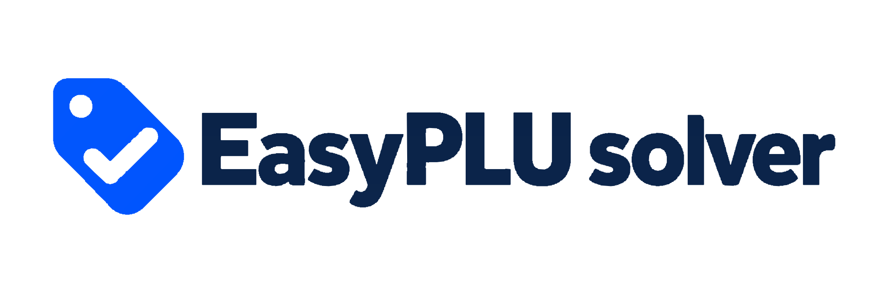

<p align="center">
  
</p>

# EasyPLU Solver

Next.js interface and FastAPI service for EasyPLU tests, optional scheduled runs, and a downloadable product handbook.

**Try it out:** [plusolver.com](https://plusolver.com)

See [setup and usage](docs/README.md) and [architecture](docs/architecture.md).

```bash
bash scripts/install.bash
bash scripts/devstart.bash
```

Production: `bash scripts/prodstart.bash`. Python checks: `.venv/bin/python -m unittest discover -s tests -v`.
